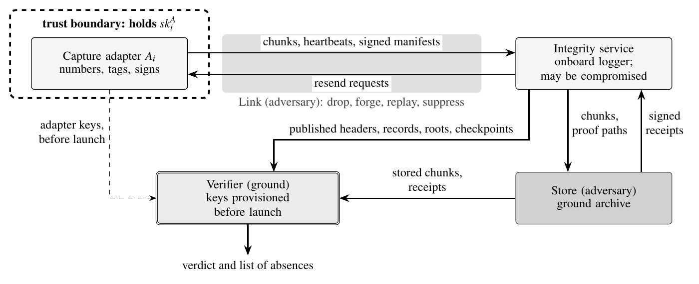
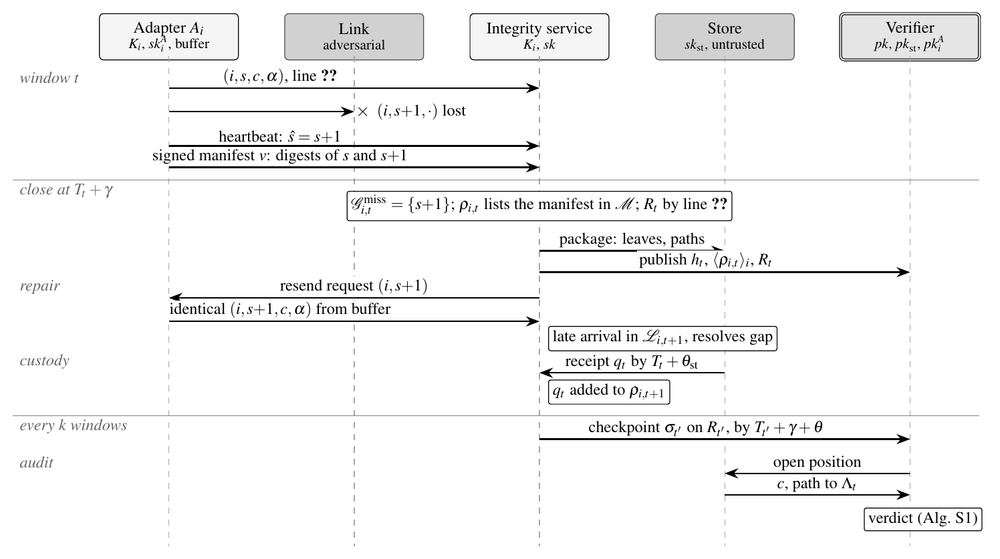
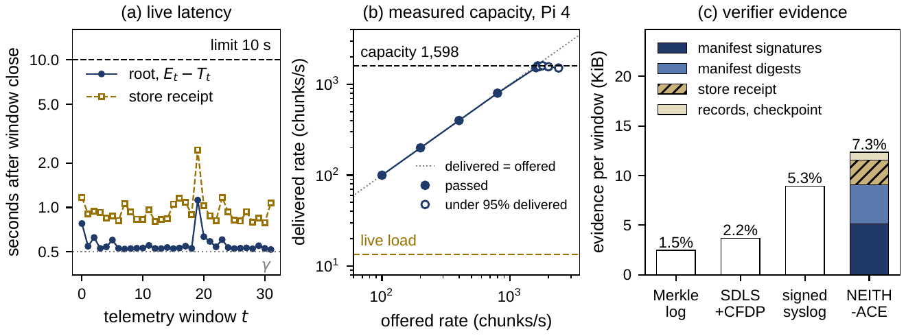

# NEITH-ACE

**Authenticated telemetry completeness and loss attribution for small-spacecraft flight software**

Code, attack injector, and measurement logs for

> M. El-Hadedy, "NEITH-ACE: Authenticated Telemetry Completeness and Loss Attribution for Small-Spacecraft Flight Software," submitted to the *Journal of Hardware and Systems Security* (Springer), November 2026. Extends NEITH (IEEE SATC 2026).

After an anomaly, a spacecraft's telemetry is often the only evidence, and an authentic record can still be incomplete. NEITH proves that what reached the onboard logger was not changed. NEITH-ACE proves the record is **complete against the source**: each capture adapter signs chained manifests of the chunks it captured, under a key the logger never holds. A verifier on the ground can then say exactly what is missing and where the evidence for each missing chunk ends, **even if the logger is compromised**.

## How it works



*Capture adapters number, tag, and sign what they capture. The integrity service (the onboard logger) commits each 10 s window into a Merkle root that also records what is missing, failed, or late, and signs checkpoints with XMSS. The ground store signs receipts for what it keeps. The verifier combines all of it and returns a verdict plus the list of missing chunks.*



| Verdict | Meaning |
|---|---|
| **Complete** | every declared chunk is present and verified |
| **Repaired** | chunks were lost, then resent and verified |
| **Accounted** | chunks are missing; each is listed with where its evidence ends |
| **Prefix** | the record is consistent so far; later evidence is not due yet |
| **Stale** | a sensor went silent, so its status is unknown after that point |
| **Withheld** | published evidence stops before it should |
| **Invalid** | a signature, chain, or root does not verify |

Each missing chunk gets one of four classes: `IngestAbsent` (never reached the logger), `IngestAuthFail` (arrived with a bad tag), `HandoffAbsent` (never acknowledged by the store), `CustodyLoss` (the store lost or changed it).

## Results

### Live run on real hardware

Raspberry Pi 4 adapters reading a live u-blox GNSS receiver and a LiDAR, a Pi Zero 2 W integrity service, and a separate ARM board as a **cheating store**, with **5% link loss**, 32 windows of 10 s:

| Measured | Value |
|---|---|
| Chunks dropped by the link | 205 |
| Chunks repaired by authenticated resend | **205 (all)** |
| Chunks the store altered | 11 |
| Chunks the verifier flagged as `CustodyLoss` | **exactly those 11, no others** |
| Verdict | Accounted |
| Root published after window close | ≈0.5 s median (limit 10 s) |
| False "Complete" | 0 |



*(a) Root and store-receipt latency per window in the live run. (b) Measured capacity of the whole pipeline on one Pi 4: 1,598 chunks/s of 8 KiB (13.1 MB/s), about 120× the live load. (c) Evidence per window by format; the reference encoding of NEITH-ACE measures 17.7 KiB, 10.4% of the telemetry.*

### Comparison with existing mechanisms (Table 4)

Each mechanism reimplemented and run on the same 20 injected missions per cell, real cryptography, scored against ground truth. ❌ = certified an incomplete record as complete.

| Mechanism | benign | link loss | store deletes | service fabricates | service hides newest |
|---|---|---|---|---|---|
| Merkle log (CT) | COMPLETE | COMPLETE ❌ | DETECTED | COMPLETE ❌ | COMPLETE ❌ |
| Nitro (CCS 2025) | COMPLETE | COMPLETE ❌ | DETECTED | COMPLETE ❌ | COMPLETE ❌ |
| Signed syslog (RFC 5848) | COMPLETE | DETECTED | DETECTED | DETECTED | COMPLETE ❌ |
| Signed syslog + freshness | COMPLETE | DETECTED | DETECTED | DETECTED | STALE |
| SDLS + CFDP (CCSDS) | COMPLETE | REPAIRED | n/a | COMPLETE ❌ | COMPLETE ❌ |
| DASLog | COMPLETE | DETECTED | DETECTED | DETECTED | DETECTED |
| **NEITH-ACE** | COMPLETE | **REPAIRED** | **ACCOUNTED** | INVALID | STALE / PREFIX |

Mechanisms that trust the logger are fooled. Source-signed ones detect the attacks, but only NEITH-ACE also repairs the loss and says where each missing chunk was lost.

### Capacity sweep (Fig. 3b)

Whole pipeline on one Pi 4: two adapters, integrity service, and store with durable writes; a checkpoint signed in every window (worst case). A rate passes when the verdict is Complete, every window meets its deadline, and the adapters deliver at least 95% of the offered rate.

| Offered (chunks/s) | Delivered | Worst root delay (s) | Verdict | Passed |
|---:|---:|---:|---|---|
| 100 | 99.9 | 0.65 | Complete | yes |
| 200 | 199.9 | 0.76 | Complete | yes |
| 400 | 399.9 | 0.96 | Complete | yes |
| 800 | 799.8 | 1.32 | Complete | yes |
| 1600 | 1522.7 | 2.50 | Complete | yes |
| **1650** | **1597.7** | 2.22 | Complete | **yes** |
| 1700 | 1567.4 | 2.17 | Complete | no (under 95%) |
| 1800 | 1603.0 | 2.37 | Complete | no (under 95%) |
| 2000 | 1559.5 | 3.85 | Complete | no (under 95%) |
| 2400 | 1512.5 | 4.39 | Complete | no (under 95%) |

Every run ended Complete: above about 1,600 chunks/s the adapters could not produce chunks as fast as offered on the shared cores. No data was lost.

### Cost on a Raspberry Pi 4

| Operation (8 KiB chunk) | Median |
|---|---:|
| SHAKE128 hash | 47.7 µs |
| BLAKE3 hash | 41.1 µs |
| Ascon-XOF128 hash (C, opt64) | 97.7 µs |
| KMAC128 tag | 114.3 µs |
| Keyed Ascon-CXOF128 tag | 113.4 µs |
| XMSS h=10 sign (incl. state write) | 30.2 ms (max 41.1 ms) |
| XMSS h=10 verify | 2.3 ms |
| XMSS h=10 signature / public key | 2,500 B / 68 B |
| XMSS h=16 key generation | 274 s |

Inside NASA's F′ flight-software framework on the same Pi 4, the capture-adapter component sealed each manifest in a **54.8 ms median** (23 manifests) of its 10 s period.

### Attack campaign (Online Resource 1)

44 scenarios × 8 randomized missions each, with signed manifests and with a MAC-only variant. A trial passes only if the verdict **and the exact set of missing chunks** match ground truth. **352/352 passed in both modes.** The MAC-only column shows the counterexample: when the logger is compromised, MAC-only declarations can be made to report Complete (bold ❌); signed manifests cannot.

<details>
<summary>All 44 scenarios</summary>

| # | Scenario | Attacker | Verdict (signed manifests) | Passed | Verdict (MAC-only) |
|---|---|---|---|---|---|
| 1 | benign | none | COMPLETE | 8/8 | COMPLETE |
| 2 | retransmit | none | COMPLETE | 8/8 | COMPLETE |
| 3 | drop-chunk | link | ACCOUNTED | 8/8 | ACCOUNTED |
| 4 | drop-burst | link | ACCOUNTED | 8/8 | ACCOUNTED |
| 5 | silence-chunks+heartbeats | link | STALE | 8/8 | STALE |
| 6 | modify-payload | link | ACCOUNTED | 8/8 | ACCOUNTED |
| 7 | inject-forged-chunks+heartbeats | link | COMPLETE | 8/8 | COMPLETE |
| 8 | replay-old-chunks | link | COMPLETE | 8/8 | COMPLETE |
| 9 | reorder-within-window | link | COMPLETE | 8/8 | COMPLETE |
| 10 | delay-across-window | link | REPAIRED | 8/8 | REPAIRED |
| 11 | delete-window | publication | INVALID | 8/8 | INVALID |
| 12 | insert-window | publication | INVALID | 8/8 | INVALID |
| 13 | swap-windows | publication | INVALID | 8/8 | INVALID |
| 14 | truncate-tail | publication | WITHHELD | 8/8 | WITHHELD |
| 15 | substitute-record+recompute-chain | publication | INVALID | 8/8 | INVALID |
| 16 | forge-checkpoint | publication | INVALID | 8/8 | INVALID |
| 17 | withhold-receipt | custody | ACCOUNTED | 8/8 | ACCOUNTED |
| 18 | tamper-handoff | custody | ACCOUNTED | 8/8 | ACCOUNTED |
| 19 | delete-stored-chunk | custody | ACCOUNTED | 8/8 | ACCOUNTED |
| 20 | substitute-stored-chunk | custody | ACCOUNTED | 8/8 | ACCOUNTED |
| 21 | drop-burst+repair | link | REPAIRED | 8/8 | REPAIRED |
| 22 | modify-payload+repair | link | REPAIRED | 8/8 | REPAIRED |
| 23 | drop-burst+repair-after-retry | link | REPAIRED | 8/8 | REPAIRED |
| 24 | drop-burst+requests-suppressed | link | ACCOUNTED | 8/8 | ACCOUNTED |
| 25 | forged-resend-requests | link | COMPLETE | 8/8 | COMPLETE |
| 26 | compromised-IS: erase gaps + re-sign | service | ACCOUNTED | 8/8 | ACCOUNTED |
| 27 | compromised-IS: fabricate chunks | service | INVALID | 8/8 | **COMPLETE** ❌ |
| 28 | compromised-IS: omit manifests | service | WITHHELD | 8/8 | INVALID |
| 29 | compromised-IS: hide newest blocks | service | STALE | 8/8 | **COMPLETE** ❌ |
| 30 | duplicate-inflation | link | COMPLETE | 8/8 | COMPLETE |
| 31 | receipt-bound-to-wrong-window | custody | ACCOUNTED | 8/8 | ACCOUNTED |
| 32 | compromised-IS: fake gap then fabricated late leaf | service | INVALID | 8/8 | INVALID |
| 33 | compromised-IS: fake gap then duplicate leaf | service | INVALID | 8/8 | INVALID |
| 34 | compromised-IS: forge unreceipted last window | service | INVALID | 8/8 | PREFIX |
| 35 | compromised-IS: substitute genesis | service | INVALID | 8/8 | INVALID |
| 36 | honest history, late audit | none | COMPLETE | 8/8 | COMPLETE |
| 37 | honest history, late audit, shutdown on a scheduled checkpoint | none | COMPLETE | 8/8 | COMPLETE |
| 38 | checkpoint not yet due at audit | publication | PREFIX | 8/8 | PREFIX |
| 39 | drop-manifest+repair | link | COMPLETE | 8/8 | COMPLETE |
| 40 | drop-manifest+requests-suppressed | link | STALE | 8/8 | **COMPLETE** ❌ |
| 41 | honest history, shutdown on a scheduled checkpoint, on-time audit | none | COMPLETE | 8/8 | COMPLETE |
| 42 | shutdown checkpoint on a scheduled window withheld | publication | WITHHELD | 8/8 | WITHHELD |
| 43 | compromised-IS: end checkpoint in mid-history | service | INVALID | 8/8 | INVALID |
| 44 | receipt with a short bitmap | custody | ACCOUNTED | 8/8 | ACCOUNTED |

</details>

## Quick start

```bash
git clone https://github.com/mealycpp/neith-ace && cd neith-ace
./build.sh                     # builds the Ascon and XMSS native libraries, installs pycryptodome
python3 examples/quickstart.py
```

```
honest mission                         verdict COMPLETE  missing 0
link drops a burst                     verdict ACCOUNTED missing 6
                                        sensor 0 chunk 169: IngestAbsent
                                        sensor 0 chunk 170: IngestAbsent
                                        ...
link drops a burst, resends allowed    verdict REPAIRED  missing 0
```

Using the library directly:

```python
import neith_ace as na

cfg = na.Config(decl="signed")                    # Δ = 10 s windows, XMSS-signed manifests
H   = na.hash_backends()["shake128"]
mac = na.mac_backends()["kmac128"]
key = na.XMSS("XMSS-SHAKE256_10_256")

adapter = na.Adapter(cfg, 0, b"k" * 16, mac, H=H, signer=key)
msg = adapter.chunk(b"telemetry bytes")           # numbered, tagged chunk for the link
manifest = adapter.manifest()                     # signed, chained list of what was captured
```

Tested on a Raspberry Pi 4 and on x86-64 Linux.

## Reproduce the paper

| Paper item | Command | Output in this repo |
|---|---|---|
| Attack campaign | `python3 attacks.py --trials 8 --out results/x` (add `--decl mac` for MAC-only) | `results/attacks_rev16_signed/`, `results/attacks_rev16_mac/` |
| Table 4, comparison | `python3 sota.py --out results/x` | `results/sota_rev17/` |
| Fig. 3(a), live run | `live.py` on three machines, below | `results/live/` |
| Fig. 3(b), capacity | `python3 capacity.py` (about 25 min on a Pi 4) | `results/capacity/` |
| Cost table | `python3 bench.py` | `results/bench_clusterhat.json` |
| F′ adapter | see `fprime/README.md` | `results/fprime/` |
| Edge-case tests | `python3 tests/test_pending_custody.py` and `python3 tests/test_receipts_openings.py` | |

`attacks.py` and `sota.py` use the fixed seed 2026. `attacks.py` simulates time so it can run many missions; its cryptography is real.

### Live run on three machines

```bash
# store and verifier (start first); --malicious 1 makes the store cheat
python3 live.py store --port 7701 --xmss XMSS-SHAKE256_10_256 --out results/net --malicious 1

# integrity service; --drop injects link loss, --repair requests resends
python3 live.py serve --windows 32 --drop 0.05 --repair 1 --store <STORE_IP>:7701 --out results/net

# capture adapters with real sensors
stty -F /dev/ttyUSB0 230400 raw -echo; stty -F /dev/ttyACM0 raw -echo
python3 live.py adapter --connect <SERVICE_IP>:7700 --id 0 --source serial:/dev/ttyACM0 --out results/net &
python3 live.py adapter --connect <SERVICE_IP>:7700 --id 1 --source serialblock:/dev/ttyUSB0:8192 --out results/net &
```

## Files

| Path | Contents |
|---|---|
| `neith_ace.py` | the scheme: adapter, manifests, integrity service, store, verifier, Merkle tree, XMSS and Ascon wrappers |
| `attacks.py` | the 44 attack scenarios, checked against ground truth |
| `sota.py` | reimplementations of existing mechanisms for Table 4 |
| `live.py` | real-time pipeline over TCP (`adapter`, `serve`, `store`) |
| `capacity.py` | capacity sweep behind Fig. 3(b) |
| `bench.py` | cost of hashes, MACs, and XMSS signing |
| `examples/quickstart.py` | three small missions and their verdicts |
| `fprime/` | F′ capture adapter and custodian components |
| `tests/` | edge-case tests |
| `baselines.py` | earlier internal baselines, kept for reference |
| `make_tables.py` | builds the LaTeX tables from the results |
| `native/`, `vendor/` | C glue and vendored ascon-c, xmss-reference, pyascon |

## Citation

Until the journal article appears, please cite the conference paper:

```bibtex
@inproceedings{elhadedy2026neith,
  author    = {El-Hadedy, Mohamed},
  title     = {{NEITH}: Networked Evidence Integrity for Telemetry Hashing},
  booktitle = {2026 IEEE 2nd International Conference on Secure IoT, Assured and Trusted Computing (SATC)},
  year      = {2026},
  pages     = {1--5},
  doi       = {10.1109/SATC69565.2026.11542491}
}
```

## License

MIT (`LICENSE`). Code under `vendor/` is CC0-1.0 by its original authors.

## Acknowledgements

Developed in the Reconfigurable Space Computing Lab, California State Polytechnic University, Pomona. Supported by the U.S. Navy Naval Engineering Education Consortium (N00174-23-1-0002), the ONR Summer Faculty Research Program, the U.S. Army Research Office (W911NF-24-1-0265), and the Air Force Research Laboratory (FA8650-24-2-2403). AMD provided development boards. The views expressed are the author's and do not necessarily represent those of AFRL or the U.S. Government.
