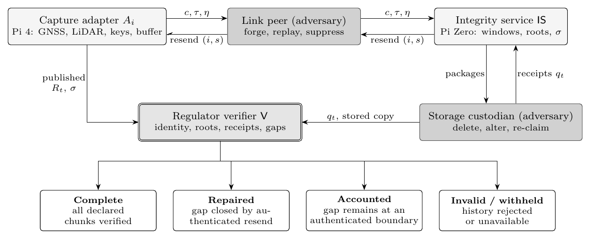
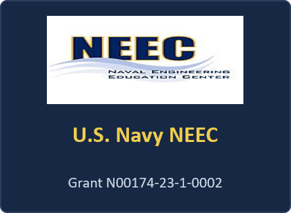
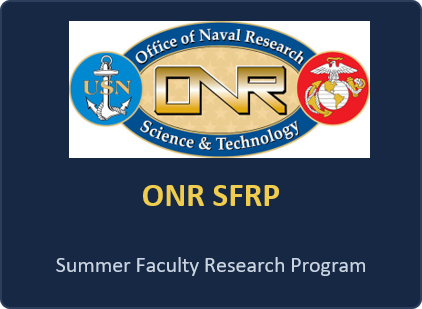
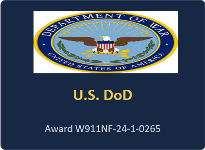
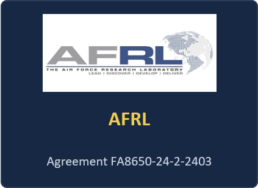

<p align="center">
  
</p>

# NEITH-ACE

Reference implementation, attack injector, and benchmark scripts for **NEITH-ACE: Authenticated Completeness and Loss Attribution for Edge Telemetry**, the journal extension of NEITH (IEEE SATC 2026).

NEITH committed *what arrived*. NEITH-ACE commits *what should have arrived*, *what actually arrived*, and the last authenticated boundary each item crossed — and keeps that account verifiable **even when the integrity service is fully compromised**. Every number in the paper comes from these scripts running on real hardware. Hashing, MACs, XMSS signatures, `fsync`'d store persistence, and TCP transport are all real; only `attacks.py` simulates time so it can run thousands of missions, and its cryptography is real too.

<p align="center">
  
</p>

The adversary sits on the link between the capture adapter and the integrity service, and again as the downstream storage custodian; the regulator verifier is independent. It may hold the telemetry but cannot make its own, replayed, or altered data appear to originate freshly from the adapter.

## What it does

Telemetry flows from per-sensor **capture adapters** → an **integrity service** → an untrusted **storage custodian**, and an independent **regulator verifier** audits the result. Each adapter signs a chained **manifest** of the digests it captured, under a key the service never holds, so completeness is judged against the capture source rather than the intermediary. Window roots chain and are checkpointed with XMSS. The verifier returns one of **Complete / Repaired / Accounted / Stale / Withheld / Invalid / Prefix**, with the exact set of missing items and, under an honest service, the boundary each crossed.

The headline guarantee: a compromised integrity service — holding the admission keys and its own signing key — **cannot certify an incomplete subset of the adapter's declared record as complete**.

## Layout

| File | Role |
|---|---|
| `neith_ace.py` | the construction: adapter, manifests, integrity service, store, verifier, Merkle tree, XMSS/Ascon wrappers |
| `attacks.py` | 28 scenarios × N randomized missions; verdict **and exact absence set** must match ground truth |
| `baselines.py` | five systems (NEITH / seq-log / ACE-MAC / ACE-no-repair / full ACE) over identical traces |
| `bench.py` | primitive costs: hashes, MACs, tree/record/root, XMSS h=10/16/20 (keygen, sign incl. fsync, verify, sizes) |
| `live.py` | real-time pipeline over TCP: `adapter`, `serve` (integrity service), `store` (custodian + regulator) |
| `make_tables.py` | emits the LaTeX tables from the result JSON/CSV |
| `run_all.sh` | one-command host / worker passes |
| `native/`, `vendor/` | C glue + vendored ascon-c, xmss-reference, pyascon (all CC0) |

## Build

```bash
./build.sh        # compiles the Ascon and XMSS native libs, installs pycryptodome
python3 -c "import neith_ace as na; na.XMSS('XMSS-SHAKE256_10_256'); print('ok')"
```

## Reproduce the experiments

**Single host** (benchmarks, attacks, baselines, local live runs):
```bash
nohup ./run_all.sh pi4 > pi4.out 2>&1 &
```

**Three authority domains over the network** — capture adapters on the edge host, integrity service on a separate edge node, store + regulator on a separate machine:
```bash
# storage + regulator (start first); --malicious 1 makes it a Byzantine custodian
python3 live.py store --port 7701 --xmss XMSS-SHAKE256_10_256 --out results/net [--malicious 1]

# integrity service; --drop injects link loss, --repair requests resends
python3 live.py serve --windows 32 --drop 0.05 --store <STORE_IP>:7701 --out results/net

# capture adapters, with real sensors
stty -F /dev/ttyUSB0 230400 raw -echo; stty -F /dev/ttyACM0 raw -echo
python3 live.py adapter --connect <SERVICE_IP>:7700 --id 0 --source serial:/dev/ttyACM0 --out results/net &
python3 live.py adapter --connect <SERVICE_IP>:7700 --id 1 --source serialblock:/dev/ttyUSB0:8192 --out results/net &
```

A representative live run (ClusterHAT Pi 4 adapters with real GNSS/LiDAR → Pi Zero service → separate ARM store+regulator, Byzantine custodian, 5 % link loss): **205 dropped chunks all repaired, 11 custodian-tampered chunks attributed exactly as CustodyLoss and no others, verdict Accounted**, root emission ≈0.5 s inside a 10 s window, zero false completeness.

`--decl mac` on `serve` and `adapter` runs the MAC-only baseline, which a compromised service *can* fool — the counterexample the signed manifests close.

## Citation

```bibtex
@inproceedings{elhadedy2026neith,
  author    = {El-Hadedy, Mohamed},
  title     = {{NEITH}: Networked Evidence Integrity for Telemetry Hashing},
  booktitle = {2026 IEEE 2nd International Conference on Secure IoT, Assured and Trusted Computing (SATC)},
  year      = {2026}, pages = {1--5}, doi = {10.1109/SATC69565.2026.11542491}
}
```
The NEITH-ACE journal article is in preparation; see `CITATION.cff`.

## License

MIT for this project's code (`LICENSE`). Vendored code under `vendor/` (ascon-c, xmss-reference, pyascon) is CC0-1.0 by its original authors.

## Acknowledgements

Developed in the Reconfigurable Space Computing Lab (RSCL) at California State Polytechnic University, Pomona. Supported by the U.S. Navy NEEC (N00174-23-1-0002), the ONR Summer Faculty Research Program, the U.S. DoD (W911NF-24-1-0265), and AFRL (FA8650-24-2-2403). Development boards provided by AMD. The views and conclusions herein are the author's and do not necessarily represent the policies or endorsements of AFRL or the U.S. Government.

<p align="center">
  
  
  
  
</p>
